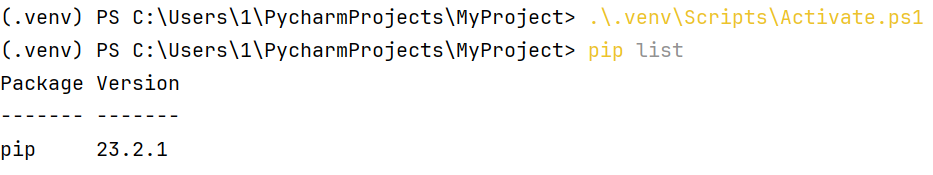
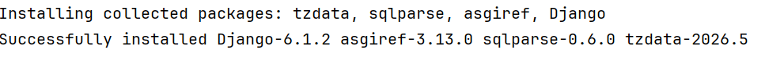
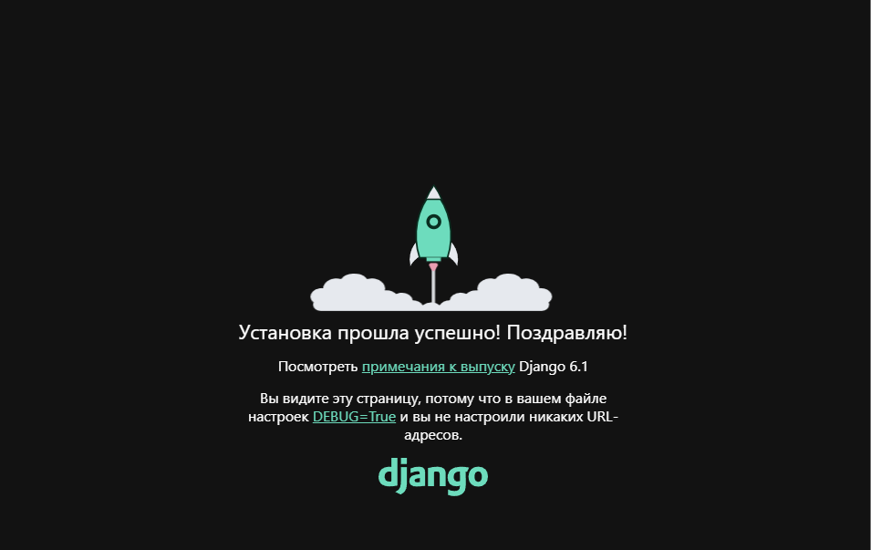
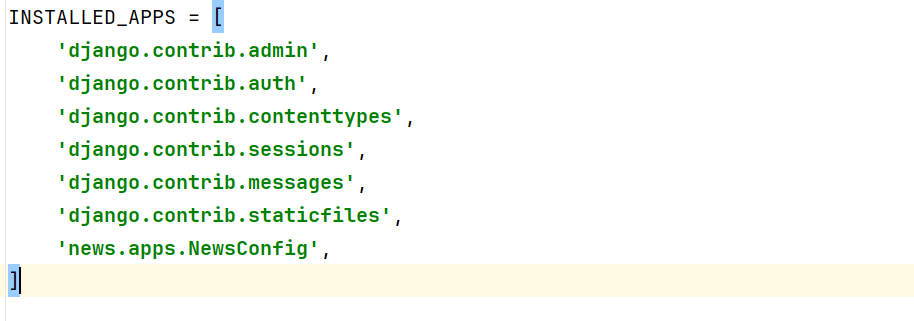
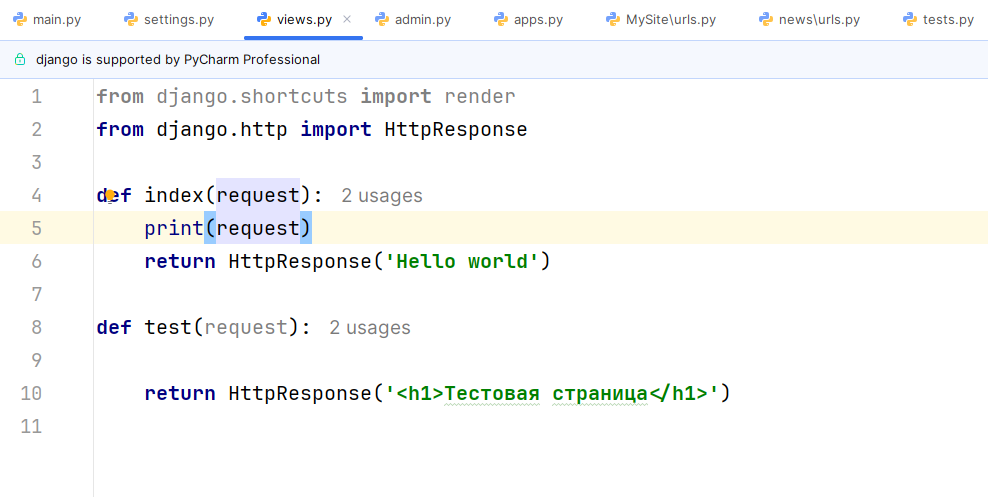
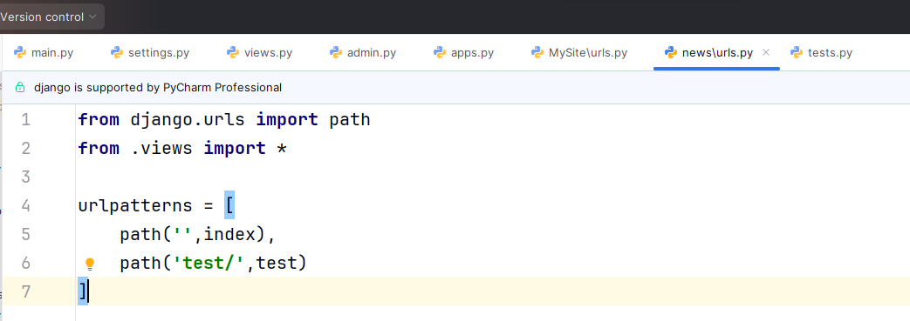
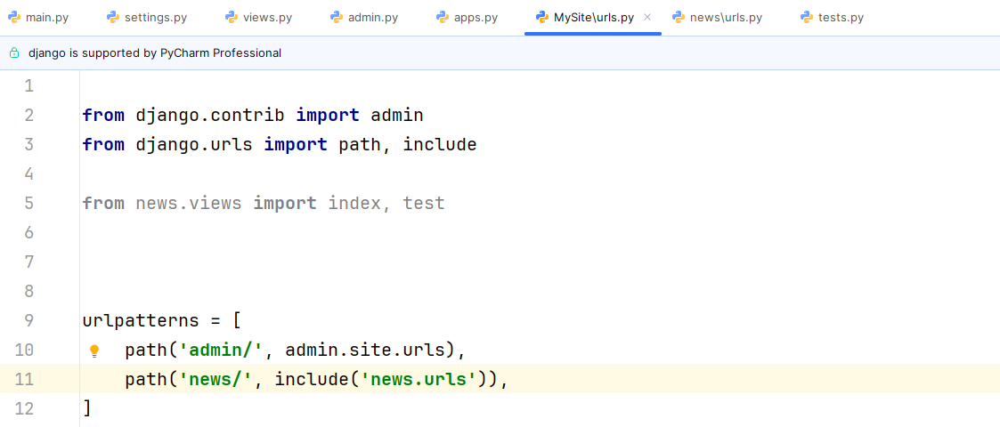
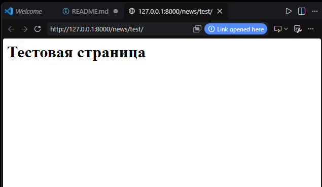
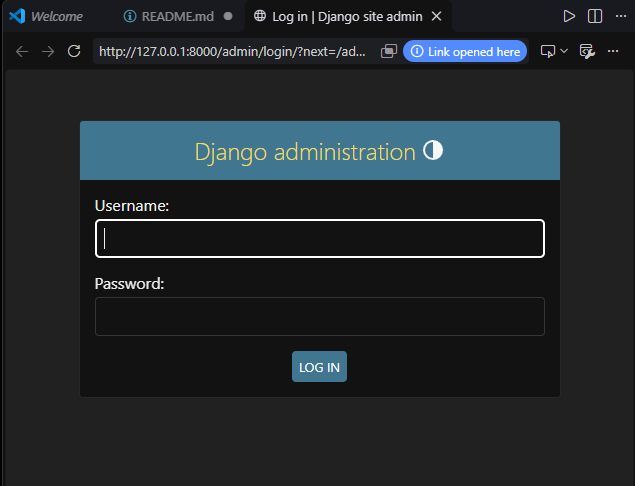

# Отчет по лабораторной работе № 1
**Ванян Давид, ПИЖ-б-о-25-2-(1)**

**Тема:** Создание виртуального окружения. Контроллеры и маршруты

**Цель работы:** Настроить виртуальное пространство. Разработать контроллер приложения и организовать маршруты.

---

## 1. Создание виртуального окружения

Я использовал второй способ — автоматическое создание средствами среды разработки PyCharm при создании проекта. 

Виртуальное окружение было успешно активировано в терминале. Об успешной активации свидетельствует префикс `(.venv)` в начале командной строки.

> **Рисунок 1.** Активация виртуального окружения и список установленных пакетов

Далее в активированное окружение был установлен фреймворк Django с помощью команды `pip install Django`.

> **Рисунок 2.** Установка Django

---

## 2. Создание проекта и запуск сервера

С помощью команды `django-admin startproject MySite` был создан новый проект Django. В дереве проекта появилась папка `MySite` с пакетом конфигурации внутри.

Для проверки работоспособности проекта был запущен сервер командой `python manage.py runserver`. Сервер успешно запустился по адресу `http://127.0.0.1:8000/`. В терминале отображаются все входящие HTTP-запросы.

> **Рисунок 3.** Запуск отладочного сервера

---

## 3. Создание приложения и его регистрация

Для создания функционала сайта было создано приложение `news` с помощью команды `python manage.py startapp news`. 

Чтобы Django корректно работал с новым приложением, оно было зарегистрировано в файле `settings.py` в списке `INSTALLED_APPS`. Нужно добавить путь к конфигурации приложения: `'news.apps.NewsConfig'`.

> **Рисунок 4.** Регистрация в settings.py

---

## 4. Создание контроллеров (views)

В файле `news/views.py` были созданы две функции-контроллера: `index` и `test`. Они принимают обязательный аргумент `request` и возвращают HTTP-ответ с помощью класса `HttpResponse`.

> **Рисунок 5.** Контроллеры в файле views.py

---

## 5. Настройка маршрутизации (urls)

Изначально маршруты были прописаны в главном файле `MySite/urls.py`. Для корректной работы импорта из приложения `news` папка `MySite` (внутренняя) была отмечена как `Sources Root` (Mark Directory as -> Sources Root).

Затем маршруты были вынесены непосредственно в приложение `news`. Для этого в папке `news` был создан файл `urls.py`. В нем объявлена переменная `urlpatterns` со списком адресов. 

> **Рисунок 6.** Файл маршрутов внутри приложения news

В главном файле `MySite/urls.py` была использована функция `include` для подключения маршрутов приложения `news`. 

> **Рисунок 7.** Подключение маршрутов приложения через include

---

Отлично, вот дополненный блок для отчета. Вставьте его перед разделом «Вывод».

---

## 6. Результаты работы сервера

После настройки всех маршрутов и перезапуска сервера (`python manage.py runserver`) были проверены следующие адреса:

> **Рисунок 8.** Результат работы маршрута `/news/test/` (вызов функции `test` из приложения `news`)

> **Рисунок 9.** Страница входа в панель администратора `/admin`

---

## Вывод

В ходе выполнения лабораторной работы я научился настраивать виртуальное окружение, устанавливать в него сторонние библиотеки (Django), создавать проекты и приложения. Также я освоил принципы работы маршрутизатора Django: создание контроллеров, настройку путей как в главном файле конфигурации, так и внутри самого приложения с помощью функции `include`, что позволяет структурировать маршруты и избегать циклических импортов.