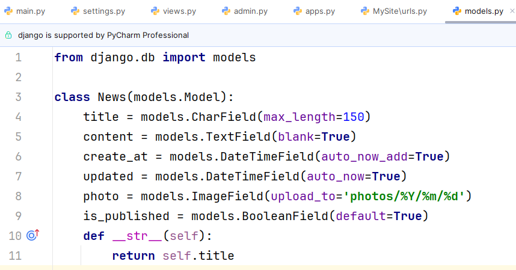
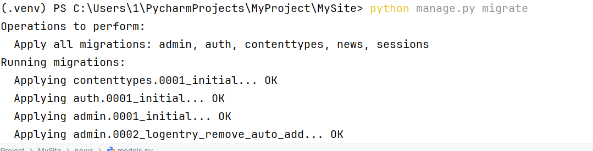
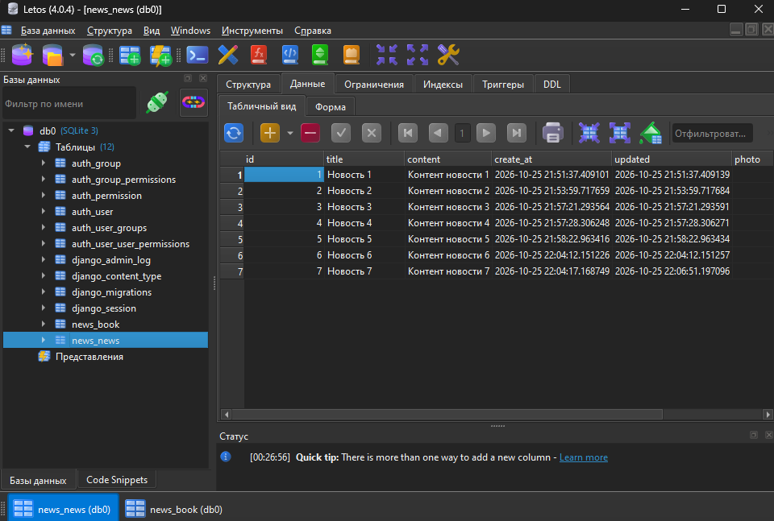
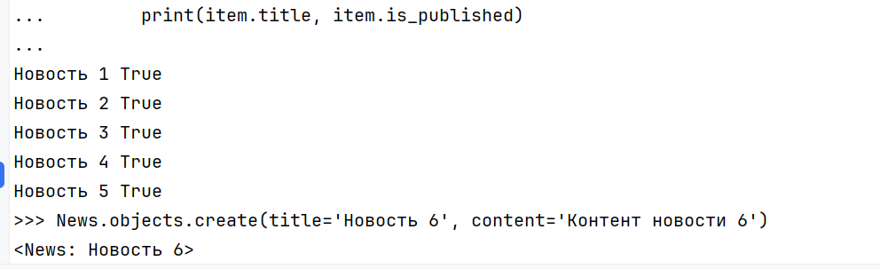
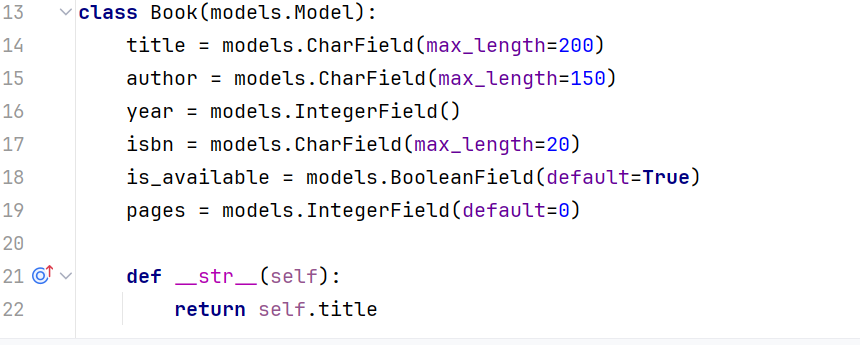
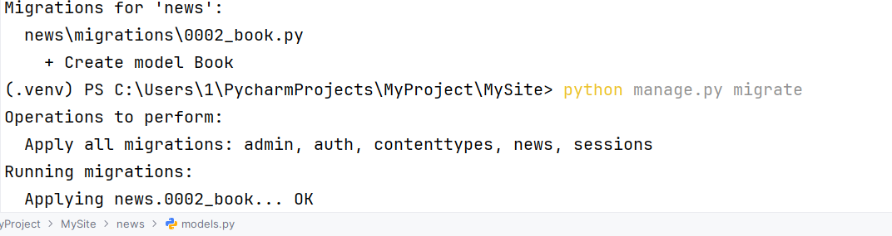

# Отчет по лабораторной работе №2

**Ванян Давид, ПИЖ-б-о-25-2-(1)**

**Тема:** Модели. CRUD

**Вариант:** 8. Книги (Book)

---

## Цель работы
Разработка моделей, научиться проводить миграцию
данных, работа с базой данных. 

## Задачи работы
1. Создать модель `News` согласно методике и настроить ее поля.
2. Подключить менеджер баз данных и применить миграции.
3. Изучить и применить на практике методы ORM (создание, чтение, обновление, удаление записей) в консоли Django.
4. Выполнить индивидуальное задание (Вариант 8): создать модель `Book`, добавить требуемое поле и выполнить фильтрацию данных.

---

## 1. Теоретическое обоснование
Модель в Django — это класс, описывающий структуру таблицы в БД. Она наследуется от `django.db.models.Model`. Миграции — это способ Django отслеживать изменения в моделях и применять их к схеме базы данных. ORM (Object-Relational Mapping) позволяет взаимодействовать с БД через Python-код, используя методы `objects.create()`, `all()`, `filter()`, `get()`, `save()` и `delete()`, не прибегая к прямому написанию SQL-запросов.

---

## 2. Практическая часть (Общее задание)

### 2.1. Создание базовой модели и настройка медиафайлов
В файле `news/models.py` была создана модель `News` с полями `title`, `content`, `create_at`, `updated`, `photo` и `is_published`. Также была настроена конфигурация для загрузки медиафайлов (в `settings.py` добавлены `MEDIA_ROOT` и `MEDIA_URL`, а в `urls.py` — маршрут для отладки).



### 2.2. Выполнение миграций
С помощью команд `python manage.py makemigrations` и `python manage.py migrate` были созданы таблицы в базе данных SQLite3. Для визуального просмотра базы данных использовался менеджер Letos.





### 2.3. Работа с CRUD через консоль Django
В интерактивной консоли (`python manage.py shell`) были выполнены операции создания записей (через конструктор и `objects.create`), чтения (`all`, `get`, `filter`), обновления и удаления. Также в модель был добавлен метод `__str__` для корректного отображения названий.



---

## 3. Индивидуальное задание (Вариант 8)

**Задание:**
- Модель: Book (поля: title, author, year, isbn, is_available).
- Добавить поле pages (целое число).
- Найти все книги, изданные после 2000 года.

### 3.1. Доработка модели
В файл `models.py` была добавлена новая модель `Book` с требуемыми полями и добавленным полем `pages`.

```python
class Book(models.Model):
    title = models.CharField(max_length=200)
    author = models.CharField(max_length=150)
    year = models.IntegerField()
    isbn = models.CharField(max_length=20)
    is_available = models.BooleanField(default=True)
    pages = models.IntegerField(default=0)

    def __str__(self):
        return self.title
```



### 3.2. Применение миграций для новой модели
После добавления модели в терминале были выполнены команды `makemigrations` и `migrate`.

**Скриншот миграции для Book:**


### 3.3. Выполнение задания
В консоли Django shell были созданы тестовые записи (книги), а затем выполнен запрос с фильтрацией по году издания.

```python

Book.objects.create(title='Война и мир', author='Толстой', year=1869, isbn='123', pages=1300)
Book.objects.create(title='Гарри Поттер', author='Роулинг', year=1997, isbn='456', pages=400)
Book.objects.create(title='Питон для всех', author='Иванов', year=2021, isbn='789', pages=250)


Book.objects.filter(year__gt=2000)
```

---

## Контрольные вопросы

**1. Что такое модель в Django и для чего она используется?**
Модель — это Python-класс (наследник `models.Model`), описывающий структуру таблицы в БД. Используется для хранения и извлечения данных через ORM, избавляя от написания SQL.

**2. Какие типы полей вы знаете? Приведите примеры.**
`CharField` (строки, требует `max_length`), `TextField` (большой текст), `IntegerField` (целые числа), `BooleanField` (True/False), `DateTimeField` (дата/время), `ImageField` (картинки). Пример: `title = models.CharField(max_length=150)`.

**3. Чем отличаются параметры blank=True и null=True?**
`blank=True` разрешает оставлять поле пустым в формах. `null=True` разрешает хранить пустое значение (NULL) в самой базе данных.

**4. Что такое миграции и зачем они нужны? Опишите основные команды.**
Миграции — это механизм применения изменений моделей к структуре БД. Команды: `makemigrations` (создать файлы миграций) и `migrate` (применить их к базе).

**5. Как создать суперпользователя для доступа к админке?**
Выполнить в терминале команду: `python manage.py createsuperuser` и задать логин/пароль.

**6. Что такое ORM? Перечислите основные методы CRUD.**
ORM (Object-Relational Mapping) — работа с БД через Python-объекты. Create: `save()`, `create()`. Read: `all()`, `filter()`, `get()`. Update: изменить атрибут + `save()`. Delete: `delete()`.

**7. В чем разница между filter() и get()?**
`filter()` возвращает QuerySet (список, даже если пустой). `get()` возвращает ровно один объект и выдает ошибку, если их несколько или нет ни одного.

**8. Как настроить загрузку изображений?**
В `settings.py` задать `MEDIA_ROOT` (путь) и `MEDIA_URL` (URL). В `urls.py` прописать маршрут через `static()` для `DEBUG=True`. В модели использовать `ImageField`.

**9. Для чего нужен метод __str__ в модели?**
Для задания понятного строкового представления объекта (например, в админке или консоли будет выводиться название, а не `<Book: Book object (1)>`).

**10. Что произойдёт, если выполнить makemigrations, но не выполнить migrate?**
Django создаст файлы миграций, но таблицы в базе данных не обновятся. Изменения не вступят в силу.